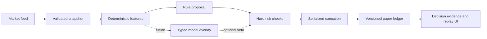

# 开源交易架构研究与 IterAlpha 迭代

研究日期：2026-10-29。本文给产品负责人阅读，代码和产品界面继续使用英文。

这次筛选了 22 个相关项目，覆盖 Jev 决策器、订单流机器人、自动交易框架和金融 AI 研究平台。不能保证穷尽网上所有项目，也没有运行这些第三方机器人或审计其收益。表格中的功能来自项目自身文档；适用性和取舍是针对 IterAlpha 的判断。没有把第三方交易代码直接复制进 MIT 项目。

## 与“赛博蜘蛛”最接近的项目

| 项目与原始来源 | 已核对的结构 | 对 IterAlpha 的启发与限制 |
| --- | --- | --- |
| [SemIf / OpenJev](https://github.com/TheoLeeCJ/SemIf-OpenJev) | 从开放权重模型读取有限选项的 logits；记录模型版本、提示哈希和计时；独立项目，不是 Jev 模型复刻 | 可作为可替换的判断服务。选项分数不是盈利概率；仍需按具体市场任务校准。原有可选推理服务已预留这一方向，本次没有部署模型。 |
| [Jarrod Watts / jev-trader](https://github.com/jarrodwatts/jev-trader) · [交易循环源码](https://github.com/jarrodwatts/jev-trader/blob/main/src/trader.ts) | Monad/Kuru 订单簿；单个在途循环；区分订单意图、回执、成交；SSE 事件流。默认 mock 动量规则，无私钥时 dry-run | 借鉴按序执行和真实状态分层。不能把区块节奏直接当作 Coinbase 成交能力，也不能把默认演示称为 Jev 实盘。 |
| [aowang-ai / jev-trade](https://github.com/aowang-ai/jev-trade) | Hyperliquid；按币隔离的 sleeve；模型、订单服务和 Next 看板分开；支持 Hold；分别配置价格刷新和决策周期 | 借鉴显示与执行分频、每币账本。其 long/short、maker/IOC 语义不等于当前 Coinbase 现货。默认同样有 mock 模型。 |
| [L1vsun / JEV-Trading-BOT](https://github.com/L1vsun/JEV-Trading-BOT) · [策略门控源码](https://github.com/L1vsun/JEV-Trading-BOT/blob/main/jev_bot/decide.py) | 订单流数学特征 → 语义桶 → 多个原子问题 → 代码组合与门控 → 延迟成交模拟；缓存输入与回答供回放 | 借鉴保存每次决策依据。多个一致回答并不构成独立证据；其阈值和合成演示收益不能直接移植。 |
| [buberlo / jev-trader](https://github.com/buberlo/jev-trader) | 特征计算、六个判断、策略政策、硬风控、报价、执行和校准分层；提供确定性 paper venue | 借鉴小而明确的判断契约、硬限制和状态/判断/结果记录。当前研究主要核对 README，未验证其报价策略的市场优势。 |
| [EthanAlgoX / jev-trading](https://github.com/EthanAlgoX/jev-trading) | 股票数据与新闻 → 云端或本地判断 → 政策检查 → 可追溯信号；演示明确使用固定响应 | 借鉴证据检查和诚实标注演示。它本身不连接券商、不执行订单，也不是 crypto 撮合引擎。 |
| [zadescoxp / Jev-Trades](https://github.com/zadescoxp/Jev-Trades) | Python 行情服务、Next 看板、指标、SQLite paper 组合、可选 Bybit 路径；迟到/乱序数据检查 | 借鉴多周期界面。README 提醒当前服务具有共享内存组合和共享活动 key；不能直接作为公开多用户账户后端。 |
| [QuantDinger](https://github.com/OpenByteInc/QuantDinger) · [Jev 门控说明](https://github.com/OpenByteInc/QuantDinger#jev-powered-pre-trade-decisions) | 研究、策略代码、回测、paper/live 和监控；Jev 作为入场前门控，退出绕过 AI，结果记录到时间线 | 借鉴保护性退出不等待模型。其文档的无 AI 时允许入场政策不是我们的默认：未经评估的模型不能自动获得交易权限。完整平台较重。 |

## 成熟执行与研究基础设施

| 项目与来源 | 可借鉴之处 | 不直接整套接入的原因 |
| --- | --- | --- |
| [Hummingbot](https://github.com/hummingbot/hummingbot) · [Executor 模型源码](https://github.com/hummingbot/hummingbot/blob/master/hummingbot/strategy_v2/models/executors.py) | Controller 与 Executor 分开；追踪订单、退出类型和执行数量；多交易所 connector | 是未来独立执行服务候选。运行方式和依赖不适合直接塞进当前 Worker；核心 Apache-2.0。 |
| [Condor](https://github.com/hummingbot/condor) | 经 Hummingbot API 管理 agent/bot；web/Telegram 控制与执行后端分离，支持 dry-run | 借鉴“用户控制面 → 确定执行服务”。当前无需接 Telegram，也不向公网开放交易账户管理接口；仓库 MIT。 |
| [Freqtrade / FreqAI](https://github.com/freqtrade/freqtrade) · [前视偏差分析](https://www.freqtrade.io/en/stable/lookahead-analysis/) | dry-run、持久化、回测、优化、模型研究；用多次切分回测检查未来数据泄露 | 可作为研究进程候选；不是 5 秒网页事件引擎。GPL 项目不能被简单拷贝后标成我们的 MIT 代码。 |
| [NautilusTrader](https://github.com/nautechsystems/nautilus_trader) | 确定性事件驱动；研究与实盘共享策略及执行语义；适配器、消息总线、缓存 | 对未来执行核心很有价值；当前重写 Rust/Python 核心会延后修复，先采用架构思想；LGPL-3.0。 |
| [CCXT](https://github.com/ccxt/ccxt) | 统一多交易所 REST/WebSocket、市场元数据和接口 | 是适配器候选，不是完整风控或账本；每家交易所的权限、费率、精度和可用地区仍需逐项验证，不能据此声称所有平台已接入。 |
| [Jesse](https://github.com/jesse-ai/jesse) | 多市场/多周期策略、指标、回测、调试与指标体系 | 借鉴策略研究体验；核心 LICENSE 是 MIT，直播交易功能与服务需另查实际可用条件。不能把框架能力当成已验证收益。 |
| [OctoBot](https://github.com/Drakkar-Software/OctoBot) | 可视界面、策略生态、自托管与多部署路径 | 借鉴“选策略 → 运行 → 监控”的产品流程；插件和云服务边界需区分，核心 GPL-3.0-or-later。 |
| [HftBacktest](https://github.com/nkaz001/hftbacktest) | L2/L3 重建、盘口队列、行情与订单延迟、逐 tick 回放 | 是将来测做市/短线成交真实性的工具；需要真实 tick/盘口数据。当前只读取盘口快照，不能伪称已模拟队列位置。 |
| [LEAN](https://github.com/QuantConnect/Lean) | 多资产事件驱动算法、历史与实时运行 | 研究/执行统一的参考，整套 C# 基础设施对当前小型 MVP 偏重。 |
| [Qlib](https://github.com/microsoft/qlib) | 数据集、训练、预测、回测、评估和实验记录统一工作流 | 适合后续实验管理，不能直接给网页一个最优 crypto 买卖答案。 |
| [FinRL](https://github.com/AI4Finance-Foundation/FinRL) | 强化学习训练与评估的教育/研究框架 | 可用于离线策略实验；奖励设计、训练分布和执行成本可能造成仿真优势消失。 |
| [FinRL-X / FinRL-Trading](https://github.com/AI4Finance-Foundation/FinRL-Trading) | 数据、策略组合、回测与券商执行通过目标权重接口衔接 | 借鉴组合目标与执行解耦；当前优先修好单账户、单币现货流程。 |
| [TradingAgents](https://github.com/TauricResearch/TradingAgents) 与 [FinRobot](https://github.com/AI4Finance-Foundation/FinRobot) | 研究、新闻、量化工具、多个角色和风险评议；均为独立项目（计入总数两个） | 适合慢速研究和解释层。我判断多次生成/讨论不适合阻塞每 5 秒的风控循环；未做延迟基准或盈利复现。 |

## 应用到本项目的结构

当前主循环继续使用规则策略；模型显示 Not connected。数学计算、仓位和执行权限留在代码。模型未来可提供“趋势/震荡、数据质量、是否放弃”等有限判断，不能通过生成文本自行发交易指令。

这次实际实现：

1. 控制写入排队，旧版本响应不能覆盖新版本；可恢复冲突只重试一次，超时先读取保存状态。
2. 暂停是幂等操作，使用旧页面版本也能停止最新账户；切换页面、隐藏和离开页面都会尝试暂停浏览器驱动账户。断网或页面被强制杀死仍无法保证请求到达，重新进入时原有 gap 规则停止补交易。
3. 每次完成的 check 保存观察时刻、买卖报价、报价年龄、来源、费用、滑点、原始现金/持仓、规则提议和检查状态。新增 Decision evidence，可选择过去的 check 查看，并随 Export checks 导出。旧记录不伪造新证据。
4. 图表周期与已创建账户的策略周期分开。切换图表不会改变原策略。
5. 行情失败有 Reconnect feed；已有服务器模式的 Binance 模拟账户可显式切到 browser feed，保留余额与成交，仍标为未验证且不参与排名。
6. 声音由根级单一服务管理；保存效果音、音乐和包括 0 在内的音量；增加试听、浏览器阻止播放提示；关音乐与离开页面清理振荡器。
7. 页面标签写入 URL，浏览器前进/后退恢复相应工作区；跨主页采用普通链接，避开观察到的框架预取错误。

## 下一阶段顺序与验收标准

- **先积累可解释的 paper 样本**：以手续费后净值、回撤、持仓时间和样本数比较现有规则与现金/买入持有基线，按市场和波动状态分组。观察到获利不能直接推导持续可盈利。
- **独立常驻行情/执行进程**：在有授权的行情源上接 WebSocket，处理序号缺口、乱序、重连、限流；网页只看状态和发送命令。恢复时先对账，绝不重放积压交易。
- **模型先做影子评估**：等 5060 到位后固定权重版本，记录模型分数/延迟/超时；不影响订单，比较规则策略与“规则+模型门控”的样本外增量。模拟环境的运行结果和模型是否实际调用都要明确展示。
- **再做可切换门控**：有限选项与弃权、期限、来源标签、版本固定；未经校准不以概率决定加仓。行情不新鲜或执行状态未知时禁止新开仓，保护退出始终由代码处理。
- **最后处理真实交易适配器**：优先已选 Coinbase 现货，先完成授权与 test/sandbox 能力核对；幂等客户订单 ID、提交/确认/部分成交/撤单/未知状态、余额与持仓对账。新增平台逐家验收，不把统一库当成全部平台已上线。

## 当前仍然存在的边界

没有实际接通 Jev、Grok 或本地开源模型，没有账户密钥，没有真实资金订单。Coinbase 行情许可尚未配置；现有 5 秒是目标观察/评估周期，网络可以使其变慢，绝不是每 5 秒强制成交。声音的浏览器解锁状态可测试，设备扬声器或系统静音需要使用者确认。

## 本轮验证记录

- 82 项自动测试通过，包含音频解锁被拒绝/永久等待、0 音量持久化、重复音乐开关清理、请求超时、请求排队、过期暂停、账本迁移和决策证据与成交分离；类型检查通过。
- 浏览器验证：效果音/音乐开关、试听、音量 0 刷新保留；Spider → Review → 浏览器后退；Spider → Home → 浏览器后退；旧账户切换 browser feed；恢复运行后离开工作区并回到暂停账户；1m 策略查看 5m 图；EMA/Bollinger/RSI 与 Line 图和 Fit chart。此次本地控制台检查未见错误。
- 暂停后仓位仍可能存在；本轮测试账户没有真实资金。本轮没有验证硬件扬声器输出、第三方机器人利润或交易所实盘成交。
